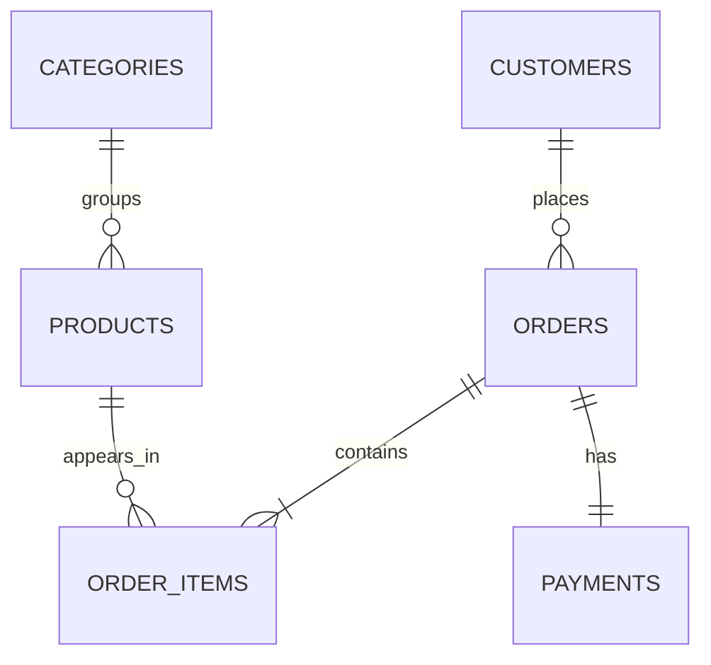

# Sales SQL Analytics

Projeto de portfólio focado em **SQL, modelagem relacional e análise de dados** usando MySQL.

## Problema de negócio
Uma operação de e-commerce precisa entender receita, ticket médio, clientes recorrentes, produtos com maior desempenho, canais de venda e risco de estoque.

## O que este projeto demonstra
- Modelagem relacional normalizada
- Chaves primárias/estrangeiras e índices
- `JOIN`, `GROUP BY`, CTEs e subqueries
- Window functions (`LAG`, `DENSE_RANK`)
- Views analíticas
- Stored procedure
- Consultas orientadas a KPIs de negócio
- Docker Compose para execução rápida

## Modelo de dados


## Estrutura
- `sql/01_schema.sql` — criação do banco e tabelas
- `sql/02_seed.sql` — massa de dados determinística
- `sql/03_views.sql` — views de apoio analítico
- `sql/04_advanced_features.sql` — stored procedure
- `sql/05_analysis_queries.sql` — 12 análises prontas

## Como executar
```bash
docker compose up -d
```
Conecte no MySQL usando `localhost:3307`, database `sales_analytics`, usuário `portfolio`, senha `portfolio`.

## Exemplos de perguntas respondidas
- Qual a receita total e o ticket médio?
- Quais produtos e categorias mais geram receita?
- Quais clientes têm maior lifetime value?
- Qual a taxa de cancelamento?
- Qual canal de venda performa melhor?
- Como a receita evolui mês a mês?

## Tecnologias
MySQL 8.4 · SQL · Docker

## Autor
Iago Serafini — estudante de Ciência da Computação com foco em Banco de Dados, Dados e Back-end.
